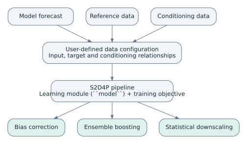
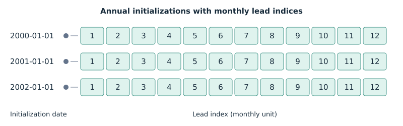
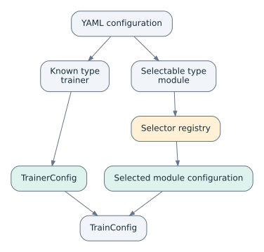
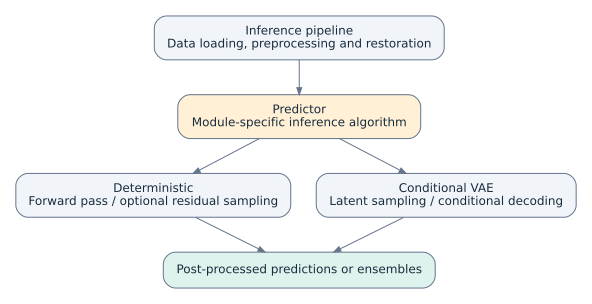
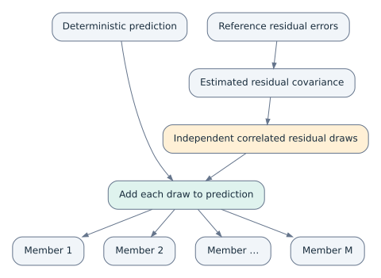

Getting Started
===============

S2D4P provides a unified machine-learning framework for post-processing subseasonal-to-decadal climate predictions. The framework currently supports three principal post-processing tasks:

* **Bias correction (bias adjustment):** Learning a mapping from climate model predictions to a reference dataset, such as observations or reanalysis, to correct systematic errors. This can can be formulated as learning the conditional distribution (conditional mean in case of a deterministic model) of a reference data given the forecast.
* **Ensemble boosting:** Generating additional ensemble members to better characterize the predictive distribution without the computational cost of additional dynamical simulations. This can be formulated as learning the (conditional) distribution of a forecast which requires a generative model.
* **Statistical downscaling:** Learning a mapping from coarse-resolution predictions to higher-resolution fields. Downscaling can be formulated similar to bias correction: learning the conditional distribution (conditional mean in case of a deterministic) of a high resolution reference given the lower resolution forecast.

These tasks are not implemented as separate pipelines. Instead, the task is implicitly defined by the combination of data sources, their spatial resolutions, the selected learning model, and the training objective specified by the user.

For example, providing model forecast and reference observations on the same spatial grid defines a bias correction problem, whereas providing higher-resolution observations defines a joint bias correction and downscaling problem. Training a compatible generative model on an existing ensemble without observations allows the model to learn the distribution of the original climate model ensemble and generate additional realizations.

These capabilities can also be combined within a single experiment, allowing the framework to simultaneously adjust, downscale, and increase the ensemble size of climate predictions.

   Post-processing tasks emerge from the experiment configuration and can be combined within the same pipeline.

A typical experiment consists of three stages: preparing and configuring the data, configuring and training a machine-learning model, and performing inference using the trained model.

*** *This document and module docstrings are generated with the help of Artifical Intelligence.* ***

1. Data
-------

1.1. Data sources
~~~~~~~~~~~~~~~~~

The S2D4P data pipeline is designed around three possible sources of data, each serving a distinct role in defining the learning problem.

.. list-table::
   :header-rows: 1
   :widths: 20 30 50

   * - Data source
     - Configuration class
     - Purpose
   * - Forecast
     - ``ForecastDataConfig``
     - Climate model predictions or ensemble simulations.
   * - Reference
     - ``RefDataConfig``
     - Reference or target data toward which predictions are adjusted.
   * - Condition
     - ``ConditionDataConfig``
     - Additional or alternative information on which predictions are conditioned.

Not all three sources are required for every experiment. Their availability and combination determine the learning task. When reference is provided, they generally constitute the training target. In their absence, a compatible generative module can learn the distribution of the model data itself.

Conditioning data can be provided independently of the forecast data or derived from the forecast ensemble, depending on the selected conditioning method. For example, ensemble generation can be conditioned on the ensemble mean, individual ensemble members, or a separate set of predictor variables.

.. important::
   Forecast data must always be specified for training.

.. list-table:: Data combinations examples
   :header-rows: 1
   :widths: 25 25 25 25

   * - Forecast
     - Reference
     - Condition
     - Application
   * - Forecast ensemble
     - Reference on the same grid
     - None separately supplied
     - Bias correction
   * - Coarse-resolution forecasts
     - High-resolution reference
     - None separately supplied
     - Bias correction and downscaling
   * - Forecast ensemble
     - None
     - Derived ensemble mean
     - Conditional ensemble boosting
   * - Forecast ensemble
     - None
     - External predictors
     - Conditional ensemble generation
   * - Forecast ensemble
     - High-resolution reference
     - External predictors
     - Conditional bias correction and downscaling

The selected learning module must be compatible with the specified data combination. Learning and sampling a conditional distribution directly requires a generative model; deterministic models can additionally support residual-based ensemble generation during inference, as discussed in Section 3.

1.2. Expected data structure
~~~~~~~~~~~~~~~~~~~~~~~~~~~~

S2D4P uses ``xarray`` as its primary data interface. Forecast data are expected to retain their initialization-time and lead-time dimensions rather than being represented exclusively along a single valid-time axis.

A typical forecast dataset may have the following structure:

Each forecast is identified by two temporal coordinates:

* ``init_time``: The initialization or reference time of the prediction.
* ``lead_time``: The forecast lead relative to the initialization time.

Together they define sampling dimensions. The names of these two dimensions can be configured in ``S2D4P/configs``.

The ensemble dimension represents multiple realizations associated with a forecast initialization and lead time.

Unlike model predictions, observational data are generally represented along a single temporal dimension containing the valid times of the observations.

The pipeline handles temporal alignment between forecasts and observations based on initialization times, lead times, and their associated valid times. Conditioning data may follow a forecast-based or time-based representation, depending on their nature and the selected conditioning method. Time-independent or static conditioning data can be used where supported.

1.3. Dimension names and conventions
~~~~~~~~~~~~~~~~~~~~~~~~~~~~~~~~~~~~

The names and roles of dimensions recognized by the pipeline are declared centrally in the package's ``configs.py`` module. This allows the framework to distinguish between sample dimensions, realization dimensions, and dimensions that constitute the input and output of the neural network.

Relevant configuration declarations include:

.. list-table::
   :header-rows: 1
   :widths: 45 55

   * - Configuration
     - Purpose
   * - ``required_sample_dimensions``
     - Declares initialization-time and lead-time dimension names.
   * - ``optional_sample_dimensions`` (where applicable)
     - Declares optional sample dimensions.
   * - ``realization_dim``
     - Identifies the ensemble or realization dimension name.
   * - ``supported_NN_dimensions_sorted``
     - Defines supported neural network dimensions and their expected ordering.
   * - ``lead_time_resolution``
     - Defines the temporal unit represented by forecast lead times.

The dimension names in the previous examples are illustrative. The actual names expected by the pipeline are determined by the package-level configuration. Required sample dimensions identify forecast samples; the realization dimension identifies ensemble membership, while neural network dimensions represent the physical or feature structure of each sample.

When the dimensions in a source dataset differ from the package conventions, they can be renamed through the ``rename_dict`` argument of the corresponding data configuration.

.. important::

   Every dimension in the input dataset must have an associated coordinate. The pipeline relies on coordinate values for selection, alignment, validation, preprocessing, and reconstruction of predictions. An unnamed positional axis is insufficient.

1.4. Temporal coordinates and calendars
~~~~~~~~~~~~~~~~~~~~~~~~~~~~~~~~~~~~~~~

Temporal coordinates must be represented by decoded datetime objects supported by ``xarray``, including ``numpy.datetime64``, compatible Python datetime representations, and ``cftime.datetime`` objects for climate model calendars.

Undecoded numerical time coordinates, integer years, or integer encodings such as ``YYYYMM`` should be converted into appropriate datetime representations before being passed to the pipeline. For annual data, January 1 of the corresponding year can be used to represent each annual time step.

This design allows temporal selection and alignment to operate on calendar-aware dates rather than assuming a fixed number of days per month or year. It is particularly important for non-Gregorian climate model calendars, such as 360-day and no-leap calendars.

1.5. Initialization-time resolution and lead-time resolution
~~~~~~~~~~~~~~~~~~~~~~~~~~~~~~~~~~~~~~~~~~~~~~~~~~~~~~~~~~~~

The pipeline distinguishes between two independent temporal resolutions.

**Initialization-time resolution** describes how frequently predictions are initialized. This resolution is inferred from the initialization-time coordinates of the provided data and is not explicitly declared by the user.

**Lead-time resolution** describes the temporal unit represented by each forecast lead. This must be explicitly declared in the package configuration, and vary based on the forecast time scale, i.e., subseasonal, seasonal or decadal.

Initialization-time and lead-time resolutions do not need to be identical. A prediction system may be initialized annually while producing monthly forecasts, or initialized monthly while producing daily forecasts.

   Each row represents an independently initialized forecast. Lead indices are defined relative to the corresponding initialization; the diagram does not prescribe a lead-to-valid-date offset.

The pipeline uses these temporal coordinates to determine valid times, align observations, validate temporal coverage, and perform calendar-aware preprocessing. Conceptually,

.. math::

   t_{\mathrm{valid}} = \mathcal{T}(t_{\mathrm{init}}, l, \Delta_l)

where :math:`t_{\mathrm{init}}` is the initialization time, :math:`l` is the forecast lead, :math:`\Delta_l` is the configured lead-time unit, and :math:`\mathcal{T}` is a calendar-aware temporal mapping following the package's lead-time indexing convention.

1.6. Data selection
~~~~~~~~~~~~~~~~~~~

Data selection is performed using the coordinates of the underlying ``xarray`` objects. The data configuration allows users to select subsets of variables, temporal periods, ensemble members, spatial domains, and other supported dimensions.

The training pipeline requries a training mask that avoid the leakage of future information into training when a reference dataset is available by masking (initial-time, lead-time) combinations that correspond to a future reference date.

A separate lead-time configuration allows users to select the forecast leads included in an experiment. An inclusive range can be specified as:

.. code-block:: yaml

   lead_times:
     start: 1
     end: 12

Alternatively, specific leads can be selected explicitly:

.. code-block:: yaml

   lead_times:
     list_lead_times: [1, 3, 6, 12]

Because temporal coordinates are represented using datetime or ``cftime`` objects, temporal selection and validation are based on actual calendar dates rather than numerical indices.

The selected training period also determines the data used for fitting preprocessing transformations, such as normalization, standardization, climatology removal, and trend removal. These fitted transformations are subsequently preserved for inference.

2. Training
-----------

The entry point to the training pipeline is a YAML configuration file, hereafter referred to as ``train_config.yaml``. This file defines the complete training experiment, including data sources, preprocessing operations, learning module (model), neural network architecture, loss function, optimization strategy, and training settings.

Usage
~~~~~~
.. code-block:: bash

    torchrun --nproc_per_node=gpu -m S2D4P.train path_to_train_config.yaml

For users working directly with the Python API, the first level of interaction with the training pipeline is the ``TrainConfig`` dataclass. It is the parent configuration class containing the configuration objects required to define a training experiment.

2.2. TrainConfig
~~~~~~~~~~~~~~~~

The fields declared in ``TrainConfig`` define the top-level arguments that can be provided in the training YAML file.

.. code-block:: python

   @dataclasses.dataclass
   class TrainConfig:
       experiment_dir: str
       max_epochs: int
       train_loader: TrainDataloaderConfig | None
       module: ModuleSelector | None
       losspipeline: LosspipelineConfig | None
       trainer: TrainerConfig | None
       optimization: OptimizerConfig | None = dataclasses.field(
           default_factory=OptimizerConfig
       )
       weights: WeightsConfig | None = dataclasses.field(
           default_factory=WeightsConfig
       )
       log_every_n_epochs: int = 5
       save_checkpoint: bool = True
       seed: int | None = None
       resume_dir: str | None = None

.. list-table::
   :header-rows: 1
   :widths: 32 68

   * - Argument
     - Description
   * - ``experiment_dir``
     - Directory in which configurations, checkpoints, logs, and other training artifacts are stored.
   * - ``max_epochs``
     - Maximum number of training epochs.
   * - ``train_loader``
     - Configuration used to construct training and validation data loaders.
   * - ``module``
     - Model module and architecture configuration.
   * - ``losspipeline``
     - Configuration defining the reconstruction loss pipeline.
   * - ``trainer``
     - Configuration controlling the training loop.
   * - ``optimization``
     - Optimizer and learning-rate scheduler configuration.
   * - ``weights``
     - Configuration used to construct spatial and variable loss weights.
   * - ``log_every_n_epochs``
     - Number of epochs between metric logging and plot updates.
   * - ``save_checkpoint``
     - Whether training checkpoints are saved.
   * - ``seed``
     - Base random seed used for reproducible training.
   * - ``resume_dir``
     - Directory of a halted experiment whose configuration and checkpoint state
        should be resumed.

The type annotations indicate the configuration class associated with each argument. Arguments with default values can generally be omitted from YAML, in which case their declared defaults are used.

A new training experiment requires the appropriate data, module, loss, and trainer configurations.

2.3. Structure of the training YAML file
~~~~~~~~~~~~~~~~~~~~~~~~~~~~~~~~~~~~~~~~

The structure of the training YAML file follows the hierarchy of ``TrainConfig``. A schematic configuration is shown below:

.. code-block:: yaml

   experiment_dir: ./experiments/example
   max_epochs: 100
   seed: 42
   save_checkpoint: true

   train_loader:
     dataset:
       model:
         # ModelDataConfig arguments
       observation:
         # ObsDataConfig arguments
       condition:
         # ConditionDataConfig arguments
       lead_times:
         start: 1
         end: 12
     # Additional TrainDataloaderConfig arguments

   module:
     type: deterministic
      config:
      # Model-specific configuration
        Architecture:
          type: UNet
          # Architecture-specific configuration

   losspipeline:
     # LosspipelineConfig arguments

   trainer:
     mixed_precision: true
     gradient_accumulation_steps: 1
     grad_clip: 1.0

   optimization:
     # OptimizerConfig arguments

   weights:
     # WeightsConfig arguments

This example illustrates the structure of the configuration rather than providing a complete executable experiment. Each nested section corresponds to another configuration class. 

.. important::
   To determine the arguments that can be provided under a section, consult the declaration of the corresponding configuration class in the API reference.

The hierarchical organization provides a consistent way to navigate the configuration system without having to manually trace the construction of every runtime component.

2.4. Loading the YAML configuration
~~~~~~~~~~~~~~~~~~~~~~~~~~~~~~~~~~~

Internally, YAML files are loaded into nested Python dictionaries and subsequently converted into configuration dataclasses using ``dacite``. 

At the top level, a ``TrainConfig`` instance is created from the YAML configuration. The package's actual loading entry point may provide additional conversion logic. Strict configuration loading helps detect unexpected arguments, including incorrectly spelled configuration keys, rather than silently ignoring them.

Recursive dataclass construction
^^^^^^^^^^^^^^^^^^^^^^^^^^^^^^^^

Because ``TrainConfig`` contains other dataclass types, ``dacite`` can recursively construct nested configuration objects. For example, consider the following YAML section:

.. code-block:: yaml

   trainer:
     mixed_precision: true
     gradient_accumulation_steps: 4
     grad_clip: 1.0

The corresponding field in ``TrainConfig`` is declared as:

.. code-block:: python

   trainer: TrainerConfig | None

Because the concrete configuration type is known from the annotation, ``dacite`` converts the nested dictionary into a ``TrainerConfig`` instance equivalent to:

.. code-block:: python

   TrainerConfig(
       mixed_precision=True,
       gradient_accumulation_steps=4,
       grad_clip=1.0,
   )

The resulting object is assigned to the ``trainer`` attribute of ``TrainConfig``. This process occurs recursively throughout the configuration hierarchy, allowing the YAML structure to closely follow the Python configuration hierarchy.

Recursive construction versus registry-based selection
^^^^^^^^^^^^^^^^^^^^^^^^^^^^^^^^^^^^^^^^^^^^^^^^^^^^^^

Recursive dataclass construction and registry-based selection solve different problems. ``dacite`` can construct a dataclass when its concrete type is known from the corresponding field annotation. It does not automatically determine which registered subclass should be instantiated from an arbitrary registry key.

For example, the following field has a predefined configuration type:

.. code-block:: python

   trainer: TrainerConfig | None

In contrast, the following field represents a choice between different learning modules:

.. code-block:: python

   module: ModuleSelector | None

Its concrete implementation depends on the user's selection. Consider:

.. code-block:: yaml

   module:
     type: deterministic

or:

.. code-block:: yaml

   module:
     type: cvae

Both configurations occupy the same position in the hierarchy but correspond to different learning modules with potentially different parameters. The selector registry resolves the specified name to the appropriate concrete configuration class. The corresponding parameters can then be converted into that configuration class.

   Conceptual distinction between ordinary recursive construction and registry-backed selection. This is not a literal call-order diagram.

Consequently, when configuring a component represented by a selector, first identify the desired registered implementation and then consult its associated configuration class. The same principle applies to registered architectures, preprocessing methods, loss components, and other extensible parts of the pipeline.

For further details, refer to the *Design Logic and Software Architecture* section.

2.5. Training experiment lifecycle
~~~~~~~~~~~~~~~~~~~~~~~~~~~~~~~~~~

Once the configuration has been loaded, the pipeline constructs the components required for training. The workflow includes data loading and validation, fitting preprocessing transformations on the training data, constructing dataloaders, initializing the learning module and architecture, configuring the loss pipeline and optimizer, and executing the training loop.

The training experiment also establishes the information required to reconstruct the pipeline during inference, including the training configuration, model checkpoints, fitted preprocessing transformations, and associated data metadata. The experiment directory serves not only as the location for training outputs but also as the reference from which subsequent inference experiments are initialized.

3. Inference
------------

Similar to training, the entry point to the inference pipeline is a YAML configuration file, hereafter referred to as ``inference_config.yaml``. For users interacting directly with the Python API, ``InferenceConfig`` is the parent configuration class and the first level of interaction with the inference pipeline.

Usage
~~~~~~
.. code-block:: bash

    torchrun --nproc_per_node=gpu -m S2D4P.inference path_to_inference_config.yaml

Unlike the training configuration, the inference configuration does not need to redefine the architecture, learning module, or training objective. Instead, the inference pipeline reconstructs the trained model using information stored in the training experiment directory.

The inference configuration primarily describes the training experiment from which the model should be restored, the inference data, prediction and sampling strategy, inference dataloader, and requested outputs.

3.2. InferenceConfig
~~~~~~~~~~~~~~~~~~~~

As with ``TrainConfig``, the fields declared in ``InferenceConfig`` define the top-level arguments that can be provided in the inference YAML file.

.. code-block:: python

   @dataclasses.dataclass
   class TrainConfig:
      experiment_dir: str
      writer: WriterConfig = dataclasses.field(default_factory=WriterConfig)
      inference_loader: InferenceDataloaderConfig = dataclasses.field(
          default_factory=InferenceDataloaderConfig
      )
      save_path: str | None = None
      seed: int | None = None
      checkpoint_name: str | None = None

.. list-table::
   :header-rows: 1
   :widths: 32 68

   * - Argument
     - Description
   * - ``experiment_dir``
     - Directory containing the trained experiment configuration, checkpoints,
        and fitted preprocessing pipelines.
   * - ``writer``
     - Configuration controlling prediction and output writing.
   * - ``inference_loader``
     - Configuration used to construct the inference data loader.
   * - ``save_path``
     - Directory in which inference outputs are saved. If ``None``, the
        ``inference`` directory under the experiment directory is used.
   * - ``seed``
     - Base random seed used during inference. If ``None``, no seed is explicitly
        configured.
   * - ``checkpoint_name``
     - Checkpoint filename to load. If ``None``, ``best.pt`` is used.

The inference configuration follows the same recursive dataclass construction and registry-based selection mechanisms described in Section 2.4. Conceptually, the hierarchy includes:

.. code-block:: text

   InferenceConfig
   |-- Reference to the training experiment
   |-- Inference dataloader configuration
   |   `-- Dataset configuration
   |       |-- ForecastDataConfig
   |       |-- ConditionDataConfig
   |       |-- Lead-time selection
   |       `-- Conditioning method
   |-- Predictor configuration
   |   `-- Model-specific inference settings
   `-- Additional inference settings

Consult each nested configuration class to identify its supported arguments, types, and default values.

3.3. Configuring the inference dataset
~~~~~~~~~~~~~~~~~~~~~~~~~~~~~~~~~~~~~~

The dataset used during inference does not necessarily need to be the same dataset used during training. Users can independently define the inference dataset through the inference YAML file, allowing a trained model to be applied to new forecast initialization times, different input files, or other compatible datasets.

If an inference dataset configuration is not explicitly provided, the relevant dataset configuration is derived from the training experiment.

Using the training dataset configuration
^^^^^^^^^^^^^^^^^^^^^^^^^^^^^^^^^^^^^^^^

When no alternative dataset configuration is specified, the pipeline uses the relevant configuration established during training. This is useful when generating predictions for data already available to the training experiment, such as held-out initialization times or forecasts reserved for evaluation.

The observational training target is not ordinarily required to generate predictions during inference. The pipeline derives the appropriate input and conditioning sources from the training configuration. Some inference strategies may additionally need reference data to estimate sampling statistics.

Providing a new dataset configuration
^^^^^^^^^^^^^^^^^^^^^^^^^^^^^^^^^^^^^

Alternatively, the user can explicitly configure a new dataset. The pipeline validates its compatibility with the trained model and the configuration established during training.

Compatibility considerations include required input and conditioning variables, input dimensions and spatial structure, temporal coordinates and lead-time conventions, conditioning method, additional time-dependent features, and fitted preprocessing transformations.

.. important::
  Inference dataloader does not need nor accepts a reference dataset.

Inference data need not cover the same initialization times as training data. However, they must satisfy the input requirements of the trained model. Passing compatibility checks does not necessarily guarantee generalization to a substantially different climate regime or data distribution.

3.4. Restoring preprocessing transformations
~~~~~~~~~~~~~~~~~~~~~~~~~~~~~~~~~~~~~~~~~~~~

Preprocessing is an integral part of a trained model. For example, if a model was trained on standardized temperature anomalies, inference inputs must be transformed using compatible standardization parameters, and outputs must be transformed back into the appropriate physical space.

Consequently, fitted preprocessing transformations are preserved during training and restored during inference.

Preprocessing transformations should not be refitted on inference data. Doing so could change the statistical representation relative to that learned during training and potentially introduce data leakage in retrospective evaluation experiments.

3.5. Predictors and module-specific inference
~~~~~~~~~~~~~~~~~~~~~~~~~~~~~~~~~~~~~~~~~~~~~

Different machine-learning models require different inference algorithms. A conventional deterministic neural network generally uses a forward pass. A conditional variational autoencoder requires sampling from a latent distribution and decoding latent representations conditional on the provided inputs.

S2D4P separates these algorithms from the general inference infrastructure through **predictors**. A predictor is responsible for implementing the sampling or prediction procedure associated with a particular learning module.

The inference pipeline handles common operations, including loading data, batching, preprocessing, restoring the trained model, and assembling predictions. The predictor handles the module-specific operations required to generate those predictions.

   Predictors separate module-specific inference algorithms from the common inference infrastructure.

This separation allows different sampling strategies to be developed for the same learning module and new models to be integrated without redesigning the common inference infrastructure.

3.6. Ensemble generation using generative models
~~~~~~~~~~~~~~~~~~~~~~~~~~~~~~~~~~~~~~~~~~~~~~~~

For generative learning modules, ensemble generation is an inherent part of inference. A generative model learns a representation of the conditional distribution of the reference data:

.. math::

   Y \sim p_\theta(Y\mid X)

where :math:`X` represents the input or conditioning information and :math:`Y` represents the target variable.

For a conditional variational autoencoder, inference generally consists of sampling latent variables:

.. math::

   z^{(i)} \sim p(z\mid X)

and generating the corresponding output samples:

.. math::

   Y^{(i)} \sim p_\theta(Y\mid z^{(i)},X).

Repeating this procedure generates an ensemble of samples conditional on the same input. Depending on the predictor and model configuration, inference may involve alternative latent sampling distributions, output noise sampling, or other mechanisms. These are generally supported by the predictors.

3.7. Ensemble generation using output noise covariance
~~~~~~~~~~~~~~~~~~~~~~~~~~~~~~~~~~~~~~~~~~~~~~~~~~~

Ensemble generation in S2D4P is not restricted to explicitly generative learning modules. Although a conventional deterministic model produces a single prediction for a given input,

.. math::

   \widehat{Y}=f_\theta(X),

an ensemble can be generated around this prediction by estimating the covariance structure of the model's residual errors.

Let the residual error be defined as:

.. math::

   \epsilon_t=Y_t-f_\theta(X_t).

This can be over training or validation sets. A conventional sample covariance estimate from an appropriate reference dataset is:

.. math::

   \widehat{\Sigma}_{\epsilon}=
   \frac{1}{N-1}\sum_{t=1}^{N}
   (\epsilon_t-\bar{\epsilon})(\epsilon_t-\bar{\epsilon})^\top.

Under a zero-mean Gaussian residual assumption, samples can be generated as:

.. math::

   \epsilon^{(i)} \sim \mathcal{N}(0,\widehat{\Sigma}_{\epsilon}),

and added to the deterministic prediction:

.. math::

   \widehat{Y}^{(i)}=f_\theta(X)+\epsilon^{(i)},
   \qquad i=1,\ldots,M,

where :math:`M` is the requested ensemble size. These equations illustrate the statistical principle rather than specifying the package's exact covariance estimator.

   A deterministic prediction is combined with independently sampled, correlated residual errors to generate multiple realizations.

Unlike independently sampled noise at each grid point, covariance-based sampling can account for spatial dependencies in residual errors and, where included in the covariance representation, dependencies between different physical variables.

See `Section 2.4 of the referenced study <https://agupubs.onlinelibrary.wiley.com/doi/10.1029/2026JH001281>`_ for the covariance-based output-noise methodology. 

This functionality is supported for the pipeline in the ``Writer`` and is configureable in ``InferenceConfig`` under ``Writer`` and can be used for both deterministic and generative models.

It is important to distinguish this approach from ensemble generation using a generative neural network. In covariance-based generation, uncertainty is modeled separately through an estimated residual distribution. Under a fixed Gaussian residual covariance assumption, the predictive distribution is Gaussian around the output prediction. This might limit its ability to represent conditional heteroscedasticity, non-Gaussianity, and more complex statistical dependencies.

Nevertheless, this provides an alternative approach to probabilistic prediction using deterministic neural networks, or sampling the output distribution of an MSE-trained generative model without requiring an explicitly generative architecture.

.. important::
  Using generators in place of determinsitic networks or sub-branches in generative models (e.g., the decoder in cVAE) is yet another approach for ensemble generation that is supported by the pipeline and requires an ensemble aware loss function (e.g., CRPS) as shown in `the refernced study <https://arxiv.org/pdf/2605.29172>`_.